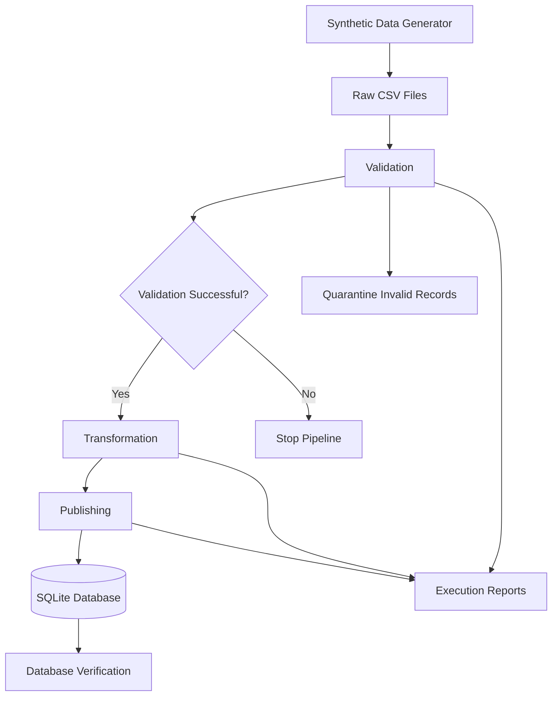

# E-Commerce Data Orchestration Pipeline

A Python-based data pipeline that generates synthetic e-commerce data, validates data quality, transforms customer and order records, and publishes clean data into a SQLite database.

The project demonstrates data quality checks, workflow orchestration, retry and timeout handling, automated testing, and repeatable database publishing.

## 1. Project Overview

The pipeline processes two datasets:

- Customers
- Orders

It follows a structured workflow:

1. Generate synthetic source data.
2. Validate customer and order records.
3. Quarantine invalid records with rejection reasons.
4. Transform valid records into standardized formats.
5. Calculate order-level total amounts.
6. Publish records into SQLite.
7. Record pipeline execution details and status.

## 2. Architecture



The orchestrator executes validation, transformation, and publishing as separate subprocess tasks. It handles retries and timeouts and prevents downstream tasks from executing after a task failure.

## 3. Technology Stack

| Technology | Purpose |
|---|---|
| Python 3.12 | Pipeline implementation |
| Pandas | Data processing and transformation |
| Faker | Synthetic data generation |
| SQLite | Target database |
| Pytest | Automated testing |
| Python Logging | Execution logging |
| Subprocess | Task orchestration |
| Jupyter Notebook | Exploration and development |
| Git and GitHub | Version control |

## 4. Project Structure

```text
yottaflex_data_orchestration/
│
├── data/
│   ├── raw/
│   ├── processed/
│   ├── quarantine/
│   ├── sample/
│   └── warehouse/
│
├── src/
│   ├── generate_data.py
│   ├── validation.py
│   ├── transformation.py
│   ├── publishing.py
│   └── orchestrator.py
│
├── tests/
│   ├── test_validation.py
│   ├── test_transformation.py
│   ├── test_publishing.py
│   └── test_orchestrator.py
│
├── docs/
│   ├── design.md
│   └── data_dictionary.md
│
├── prompts/
│   └── ai_prompt_log.md
│
├── logs/
├── reports/
├── data_exploration.ipynb
├── requirements.txt
├── .gitignore
└── README.md
```

## 5. Data Model

### Customers

| Column | Description |
|---|---|
| customer_id | Unique customer identifier |
| customer_name | Customer full name |
| email | Customer email address |
| city | Customer city |
| created_at | Customer registration timestamp |

Primary key: `customer_id`

### Orders

| Column | Description |
|---|---|
| source_record_id | Unique source record identifier |
| order_id | Unique order identifier |
| customer_id | Customer reference |
| order_timestamp | Order timestamp |
| quantity | Number of items |
| unit_price | Price per item |
| status | Order status |
| source_file | Source filename |

Primary key: `order_id`

Foreign key: `customer_id` references `customers.customer_id`.

### Derived field

```python
total_amount = quantity * unit_price
```

One customer can have multiple orders. Each order belongs to one customer.

See `docs/data_dictionary.md` for the complete schema and business rules.

## 6. Data Quality and Validation

The validation module checks:

- Required fields
- Duplicate customer identifiers
- Duplicate order identifiers
- Duplicate source record identifiers
- Customer references
- Email format
- Valid timestamps
- Positive integer quantities
- Non-negative unit prices
- Allowed order statuses

Invalid records are separated into quarantine CSV files. Multiple rejection reasons can be recorded for a record.

All occurrences of duplicated order IDs are rejected.

## 7. Transformation

The transformation module:

- Trims unnecessary whitespace.
- Standardizes order statuses.
- Converts timestamps into UTC ISO-8601 format.
- Converts quantities into integer values.
- Converts unit prices into numeric values.
- Calculates `total_amount`.
- Checks that transformation does not change accepted row counts.

## 8. Publishing

Clean customer and order records are published to SQLite.

The publishing module includes:

- Primary key constraints.
- Foreign key constraints.
- Quantity and price checks.
- Transaction-based publishing.
- Upsert-based publishing using `ON CONFLICT ... DO UPDATE`.
- Database count and total amount verification.

Repeated publishing of the same dataset with identical identifiers was tested without creating duplicate records.

## 9. Orchestration

The orchestrator uses Python subprocesses to execute tasks independently.

Features:

- Sequential task execution.
- Configurable retry attempts.
- Task timeouts.
- Run IDs.
- Execution timestamps.
- Task duration and status tracking.
- Failure logging.
- Prevention of downstream execution after failure.
- JSON execution reports and JSONL run history.

The pipeline currently uses three orchestrated tasks:

1. Validation
2. Transformation
3. Publishing

## 10. Installation

Requirements:

- Python 3.12 or compatible Python version.
- pip.

Clone the repository:

```bash
git clone https://github.com/SV-181002/yottaflex-data-orchestration.git
cd yottaflex_data_orchestration
```

Create a virtual environment:

```bash
python -m venv .venv
```

Activate it on Windows:

```bash
.venv\Scripts\activate
```

Install dependencies:

```bash
pip install -r requirements.txt
```

## 11. Generate Sample Data

Generate the standard sample dataset:

```bash
python src/generate_data.py --customers 100 --orders 200 --seed 42 --inject-issues
```

Generate a larger clean dataset:

```bash
python src/generate_data.py --customers 10000 --orders 100000 --seed 42
```

## 12. Run the Pipeline

From the repository root:

```bash
python -c "from src.orchestrator import run_pipeline; run_pipeline()"
```

The pipeline writes processed files, quarantine files, reports, logs, and the SQLite database into their respective project directories.

## 13. Run Automated Tests

Execute all tests:

```bash
python -m pytest tests/ -v
```

The test suite covers:

- Duplicate detection and validation.
- Required field and customer-reference checks.
- Transformation and amount calculation.
- SQLite publishing and repeated publishing.
- Task success, retry, timeout, and downstream task prevention.

### Automated test results

**14 tests passed, 0 failed.**

## 14. Scalability Verification

A clean synthetic dataset containing 10,000 customers and 100,000 orders was generated and processed successfully.

| Metric | Result |
|---|---:|
| Customers generated | 10,000 |
| Orders generated | 100,000 |
| Data generation time | 7.17 seconds |
| Complete pipeline duration | 8.56 seconds |
| Customers published | 10,000 |
| Orders published | 100,000 |
| Rejected orders | 0 |
| Pipeline status | SUCCESS |

The same 100,000-order dataset was published again. Database counts remained unchanged, confirming idempotency for repeated publishing with identical identifiers.

**Note:** These timings are observations from one local execution, not a formal performance benchmark.

## 15. Design Decisions and Assumptions

- One order represents one complete order record.
- Each order belongs to one customer.
- Each order has one quantity and one unit price.
- Timestamps are stored in UTC.
- Invalid records are quarantined rather than silently deleted.
- All occurrences of duplicated order IDs are rejected.
- SQLite is used as the target database.
- Pipeline tasks execute sequentially.

## 16. Current Limitations

- The pipeline currently uses local CSV files and SQLite.
- Orchestration is sequential rather than distributed.
- Performance results are based on a local synthetic dataset.
- Retry and timeout behavior is tested, but production-scale concurrent execution has not been implemented.
- Idempotency verification covers repeated publishing with identical identifiers; all possible source-identifier conflict scenarios have not been tested.

## 17. AI Assistance and Transparency

AI tools were used to assist with development, debugging, test design, and documentation.

The `prompts/` directory contains the recorded AI prompt history. Generated code was reviewed and tested as part of the implementation.

The candidate is responsible for understanding the implemented logic, design choices, test results, and limitations.

## 18. Future Improvements

- Add incremental data processing.
- Add support for larger file formats and multiple sources.
- Improve pipeline monitoring and alerting.
- Add more edge-case and integration tests.
- Explore parallel or distributed execution.
- Add configurable pipeline settings.

---

**Project:** E-Commerce Data Orchestration Pipeline  
**Language:** Python  
**Database:** SQLite  
**Testing:** Pytest  
